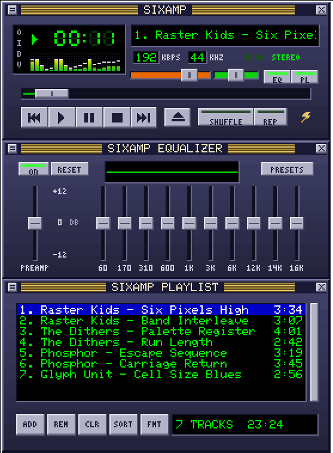

# SIXAMP

A 1990s-style MP3 player for the terminal, drawn entirely in Sixel graphics: a
spectrum analyser, a ten-band equalizer, a playlist and a file browser, all driven
by the keyboard or the mouse.



## Install

```
pip install sixamp
sixamp ~/Music
```

You can pass files, folders or `.m3u` playlists. Without arguments SIXAMP reopens your
last playlist. It plays MP3, FLAC, WAV and Ogg Vorbis on Linux, macOS and Windows.

`sixamp.py` is also a single self-contained file: with `numpy` and `miniaudio`
installed you can run `python sixamp.py` directly.

## Terminals

SIXAMP needs a terminal that shows Sixel graphics, for example foot, WezTerm,
Konsole, mlterm, iTerm2, Contour, Windows Terminal 1.22 or newer, or
`xterm -ti vt340`. Kitty and Alacritty do not support Sixel.

To check a terminal, run `sixamp --probe`: you should see coloured stripes. If the
skin looks scrambled, the terminal could not report its cell size; pass it yourself
with `--cell WIDTHxHEIGHT`, for example `--cell 10x20`.

## Keys

| Key | Action | Key | Action |
|---|---|---|---|
| `z` | previous track | `b` | next track |
| `x` | play | `c` / Space | pause |
| `v` | stop | `l` | open files |
| Left / Right | seek 5 seconds | `+` / `-` | volume |
| `[` / `]` | balance | Up / Down, Enter | choose and play a track |
| `j` | jump to a track | `i` | track info |
| `r` / `s` | repeat / shuffle | `e` / `p` | equalizer / playlist window |
| `o` / `n` | equalizer on / next preset | `f` | playlist format |
| `w` | visualizer mode | `t` | elapsed / remaining time |
| `d` | pixel scale | `?` / `q` | help / quit |

Everything on the skin also works with the mouse. The wheel scrolls the playlist,
moves the slider under the pointer, or changes the volume.

## Options

```
sixamp [--format TEXT] [--scale N] [--cell WxH] [--no-audio] [--probe] [--debug] [PATH ...]
```

`--format` sets the playlist line, for example `--format "%n. %t (%a)"`. The codes
are `%n` number, `%a` artist, `%t` title, `%l` album, `%f` file name, `%d` folder
and `%%` a percent sign. Run `sixamp --help` for everything.

Settings are stored in `~/.config/sixamp/state.json` and the log in
`~/.cache/sixamp.log`.

## pyterm

[pyterm](https://github.com/pez2001/pyterm) ships SIXAMP support built in, through its
`sixamp_support` plugin: a persistent Sixel layer, exact mouse positions and live cell
sizes across theme changes. Keep plugins enabled when you run SIXAMP there.

## Licence

MIT, see [LICENSE](LICENSE). The bundled 5x7 font comes from the Adafruit GFX Library
under the BSD licence; see [THIRD_PARTY_NOTICES](THIRD_PARTY_NOTICES).

SIXAMP is an independent project inspired by the look of classic desktop music players.
It is not affiliated with, endorsed by or connected to Winamp, Nullsoft or Llama Group.
All graphics are original.
